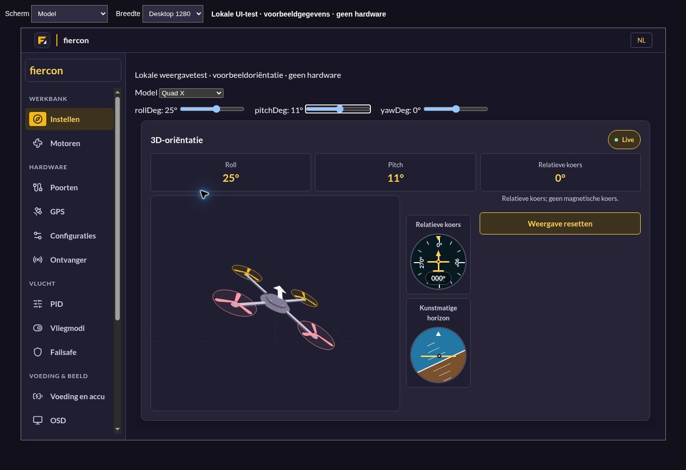
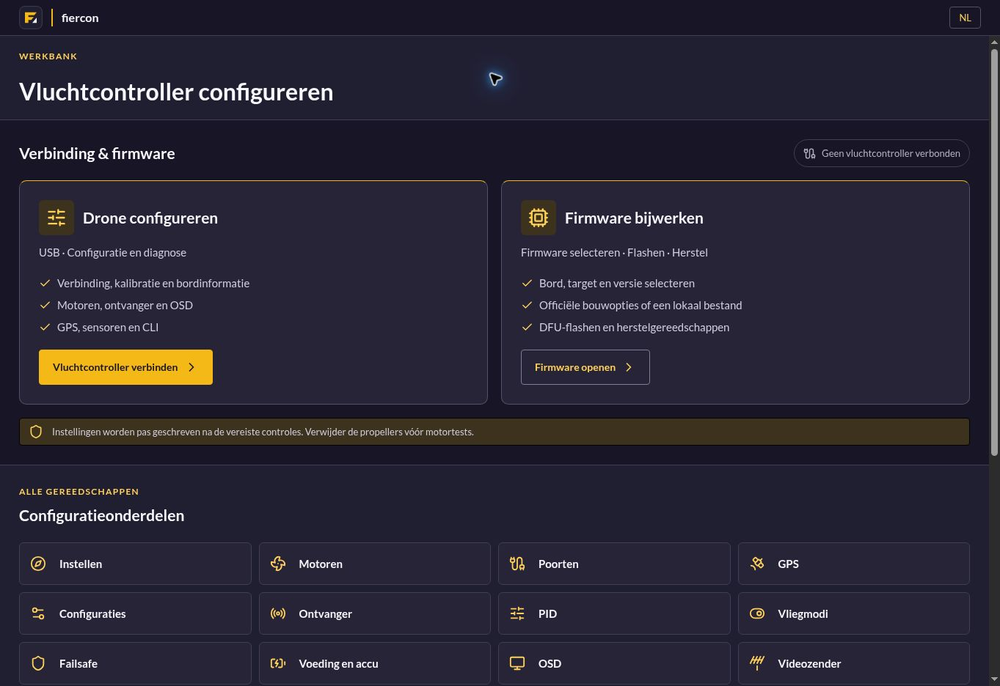

# fiercon — interfaceverificatie

De Nederlandse editie heeft de productnaam **fiercon**, een eigen gevouwen F-beeldmerk en de bestaande donkerblauw-gouden identiteit. De openbare webversie blijft op [GitHub Pages](https://fpvarabic.github.io/FPV-ARBCON-NL/). Het Arabische project is niet gewijzigd.

## Indeling en tekst

De officiële Betaflight-documentatie is gebruikt als functionele referentie voor de [Setup-indeling](https://betaflight.com/docs/wiki/app/setup-tab), [PID-profielen, rates en filters](https://betaflight.com/docs/wiki/app/pid-tuning-tab), [poortfuncties](https://betaflight.com/docs/wiki/app/ports-tab) en [motorinstellingen](https://betaflight.com/docs/wiki/app/motors-tab). Er zijn geen Betaflight-beeldmerken, schermafbeeldingen of broncode overgenomen. De Firecom-kleuren blijven gecombineerd met een eigen vormgeving.

| Onderdeel | Resultaat |
|---|---|
| Navigatie | Alle 17 bestemmingen blijven bestaan, gegroepeerd in Werkbank, Hardware, Vlucht, Voeding & beeld, Diagnose & beheer. |
| Telefoon | De knop **Alle functies** opent de volledige, scrollbare lijst met 17 onderdelen. |
| Instellingen | Compactere panelen, rustigere hoeken, duidelijke scheidingslijnen en naam/waarde-rijen. Op brede schermen staan poortcategorieën naast elkaar. |
| Setup en PID | Sectiesnelkoppelingen verplaatsen de bestaande scroller; velden blijven gemonteerd en behouden hun toestand. |
| Tekst | Inleidende paragrafen en herhaalde beschrijvingen zijn uit de werkruimte en het gidsenoverzicht verwijderd. Veldlimieten, foutredenen, hardware-instructies en veiligheidswaarschuwingen blijven aanwezig. |
| Identiteit | Webtitel, PWA, zichtbare merknaam, Android-appnaam en launcherbeeldmerk zijn bijgewerkt. De installatie-ID blijft `com.fpvarbcon.nl`. |
| Typografie | Lato blijft lokaal meegeleverd. Compactere hiërarchie, afbreekbare knoplabels en tabulaire cijfers voor de oriëntatie. |

## Interactieve modellen

Propellerringen worden nu als contouren getekend, zodat ze het frame niet bedekken. De doorschijnende schijven, statische propellerbladen, framedikte, motorzijkanten en bevestigingspunten maken het model beter leesbaar. SVG op web en Skia op Android gebruiken dezelfde geometrie en materiaaldefinities.

De echte roll-, pitch- en yaw-gegevens en de afgeleide mixer/motoropstelling blijven leidend. Een onbekende of tegenstrijdige mixer krijgt geen verzonnen quadcopter. Er is geen toegevoegde animatielus, fictieve RPM of gesimuleerde verbinding in de productie-app. De modelkaart meet haar eigen beschikbare ruimte, ook na een venster- of oriëntatiewissel.

## Verificatie

- Native en web TypeScript-controle: geslaagd.
- Productiewebbundel: geslaagd; Web Serial en Nederlandse veiligheidstekst aanwezig, geen Android/Skia-runtime in de browser en routes blijven gesplitst.
- ESLint: 0 fouten, 472 waarschuwingen in de bestaande codebasis.
- Volledige Jest-audit: 484 suites en 9026 tests uitgevoerd. De eerste run vond 12 gevallen in 7 suites: verouderde tekstverwachtingen, ontbrekende geselecteerd-feedback op sectiesnelkoppelingen en een decoratieve motornaaf met dezelfde kleur als een waarschuwing. Deze zijn verholpen. De volledige set van 7 betrokken suites is opnieuw uitgevoerd: **265 tests geslaagd**.
- Aanvullende model-, materiaal-, renderer- en LED-controles: **191 tests geslaagd**. Shell-, merk- en motordiagramcontroles: **60 tests geslaagd**.
- Browsercontrole: **84 scherm/breedte-combinaties** bij 320, 390, 768 en 1280 pixels, zonder gevonden pagina-overloop, afgeknotte labels of knoppen onder de 44-pixelgrens in de gecontroleerde toestanden.
- De mobiele gereedschappenlijst bevat 17 keuzes. De PID-snelkoppeling verplaatst de scroller daadwerkelijk. Quad X, Y6, vleugel, vliegtuig en onbekende mixer zijn visueel gecontroleerd.

De browsertests gebruiken de echte gedeelde componenten met expliciete testcontrollers; deze fixtures worden niet gepubliceerd. Ze zijn geen fysieke test van een vluchtcontroller. Er is bij deze wijziging geen APK gebouwd. Enkele bestaande Jest-fixtures houden timers open; de hercontroles beëindigen de runner na het afronden van de assertions.

De bestaande verbindingscontrole, DISARMED-bewijsvoering, schrijfverificatie, motor-stopbeveiliging en behoud van gemonteerde tabpanelen blijven in de bestaande eigenaars. Er zijn geen protocolwaarden, firmwarecommando's of sessie-eigenaars gewijzigd.

De meetresultaten staan in [de layoutaudit](verification/fiercon-layout-audit.json) en [het controleoverzicht](verification/fiercon-verification-summary.json).

## Openbare publicatie

Broncommit `3a1e45da6625c1cf508a9791f06878cedcadbeca` is gebouwd met de publieke basis `/FPV-ARBCON-NL/`. De publicatie staat op `gh-pages` in commit `22f56d37beb935ad50137c4b8da4980efc6fafc4`; Pages-run `44394459240` is succesvol afgerond. De publicatieboom is byte voor byte met de lokale Git-boom vergeleken.

Op het openbare adres zijn de naam **fiercon**, alle 17 onderdelen, het openen van firmware, de vijf gidskaarten en zeven geladen afbeeldingen in de geopende gids gecontroleerd. De app in de browser bevat geen testfixtures, donatielink of sourcemaps. Het websiteveld in GitHub About wijst naar hetzelfde publieke adres.

